<!-- ============================ HEADER ============================ -->
<p align="center">
  
</p>

<p align="center">
  <a href="https://git.io/typing-svg">
    
  </a>
</p>

<p align="center">
  <a href="https://www.linkedin.com/in/yassine-bouhramache/"></a>
  <a href="mailto:yassine.boche@gmail.com"></a>
  
</p>

<p align="center">
  
</p>

---

## 🧠 About me

```python
class YassineBouhramache:
    role       = "PhD Candidate — Applied AI"
    affiliation = "Optima AI"
    origin     = "Morocco 🇲🇦"
    research   = "Automatic risk analysis of industrial machines from multimodal documents"
    focus      = ["Multimodal RAG", "Vision-Language Models", "Knowledge Graphs", "LLM Agents"]
    values     = ["Sovereign & open AI", "Explainability", "Safety by design"]

    def currently(self):
        return "Designing the end-to-end architecture of my thesis pipeline 🏗️"
```

I started in **data science** and moved toward **applied research in multimodal AI**. Today I work on a hard, very concrete problem:

> **Can an AI system read a machine's CAD models, pneumatic & electrical schematics, photos, audio and technical descriptions — and produce a complete risk analysis, including the hazards that no document explicitly mentions?**

---

## 🔬 Current research

<table>
<tr>
<td width="55%" valign="top">

**🎯 Thesis — AI-driven machine risk assessment**

- 📂 **Heterogeneous inputs**: CAD, images, schematics (pneumatic / electrical), audio, text
- 🔍 **Visual document retrieval** with late-interaction retrievers (ColPali-style)
- 🇪🇺 **Sovereign stack**: swapping the retriever's VLM backbone for **Mistral** models
- 🧩 **Implicit risk inference**: reasoning beyond what is written in the documents
- ⚖️ Grounded in machinery-safety practice (hazard identification, risk estimation, mitigation)

</td>
<td width="45%" valign="top">

**🗺️ Pipeline (in progress)**

```text
 CAD · Schematics · Photos · Audio · Docs
                  │
        ┌─────────▼─────────┐
        │ Multimodal parsing │
        └─────────┬─────────┘
        ┌─────────▼─────────┐
        │  Visual retrieval  │  ColPali-style
        └─────────┬─────────┘
        ┌─────────▼─────────┐
        │ VLM / LLM reasoning│  Mistral
        └─────────┬─────────┘
        ┌─────────▼─────────┐
        │  Risk analysis 📋  │  explicit + implicit
        └───────────────────┘
```

</td>
</tr>
</table>

---

## 🛠️ Tech stack

**🤖 AI / ML & LLMs**

<p>
  
  <br/>
  
  
  
  
  
  
  
  
  
</p>

**🗄️ Data, vector stores & MLOps**

<p>
  
  <br/>
  
  
  
  
</p>

**💻 Software engineering**

<p>
  
  <br/>
  
</p>

**🧰 Tools**

<p>
  
</p>

---

## 📊 GitHub stats

<p align="center">
  
  
</p>

<p align="center">
  
</p>

<p align="center">
  
</p>

---

## 🤝 Let's connect

- 💬 Ask me about **multimodal RAG, VLMs, document retrieval, LLM evaluation, Python**
- 👯 Open to collaborating on **industrial AI, AI safety for machinery, and open/sovereign LLM tooling**
- 📚 Always happy to exchange papers and ideas — feel free to reach out!

<p align="center">
  
</p>
